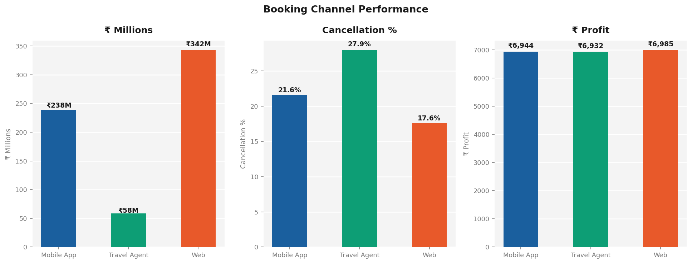
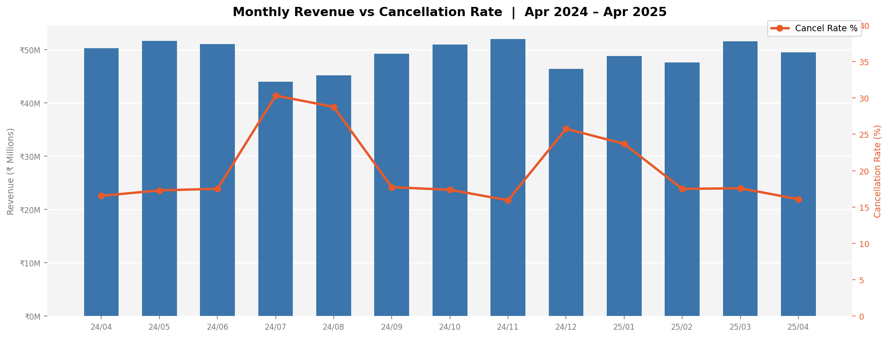
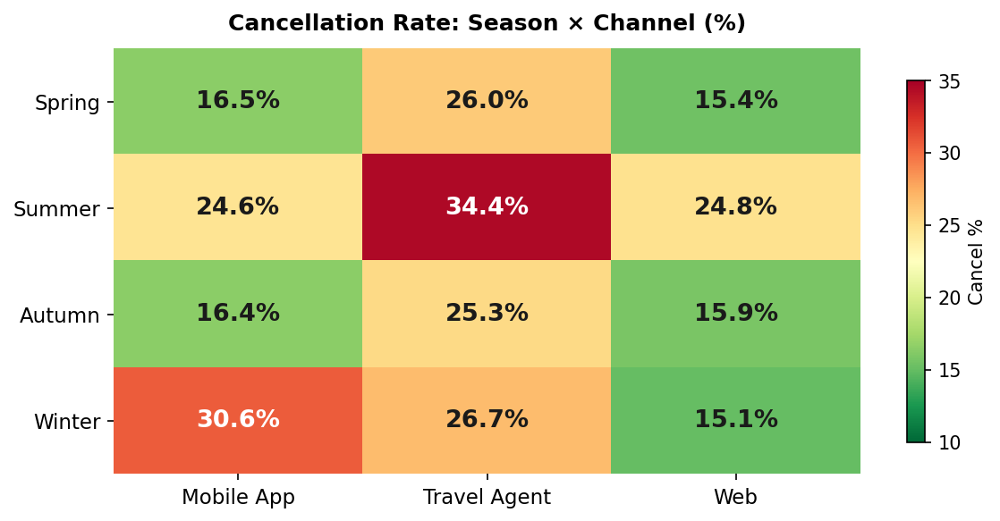
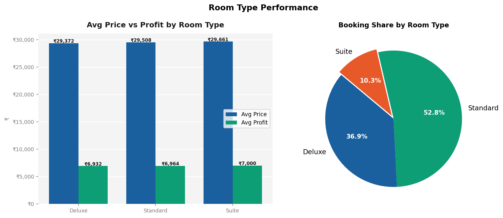
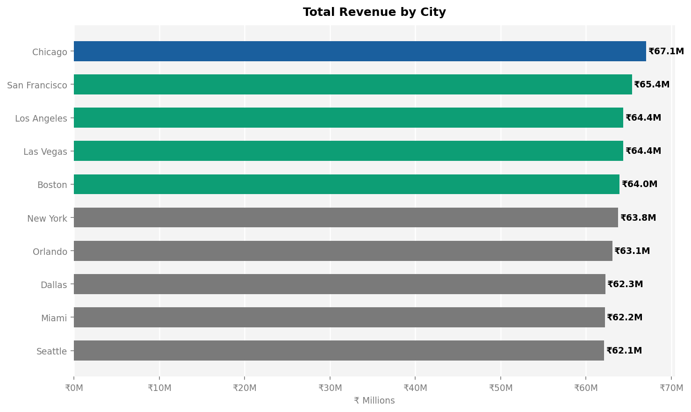
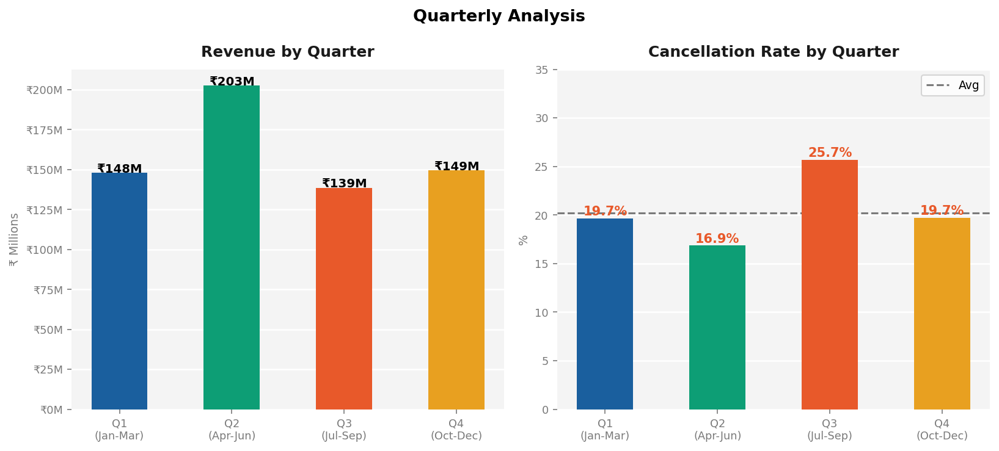
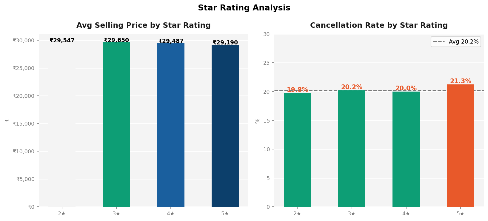
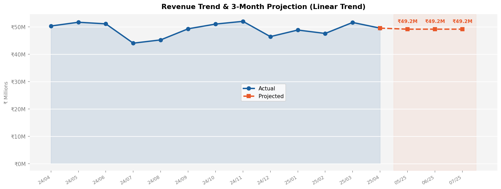

# Hotel Bookings Analysis: Where ₹146.8M of Revenue Is at Risk

**TravClan Cafe Strategy Internship assignment, by Utkarsh Yadav**

I analysed 30,000 hotel bookings across 10 US cities (April 2024 – April 2025) to answer one question: **what is actually hurting revenue?**

Short answer: demand is fine. The business has a **retention and commitment problem**. Cancellations put ₹146.8M at risk, almost a full quarter of revenue. Three specific leaks account for most of it.

📄 **Full report:** [`report/HotelBookings_Analysis_Report.pdf`](report/HotelBookings_Analysis_Report.pdf)<br>
📝 **Write-up on LinkedIn:** [I analysed 30,000 hotel bookings across 10 US cities…](https://www.linkedin.com/pulse/i-analysed-30000-hotel-bookings-across-10-us-cities-found-yadav-kpjfc/)

---

## Headline numbers

| Metric | Value |
|---|---|
| Total bookings | 30,000 |
| Confirmed / Cancelled / Failed | 21,672 (72.2%) / 6,070 (20.2%) / 2,258 (7.5%) |
| Revenue (confirmed bookings) | ₹638.8M |
| Profit (confirmed bookings) | ₹150.8M, ₹6,956 per booking on average |
| Booking value lost to cancellations | **₹146.8M** |
| Revenue trend | Flat at about ₹49M/month, −1.6% from Apr 2024 to Apr 2025 |
| Top city by revenue | Chicago (₹67.1M) |
| Projected revenue, May–Jul 2025 | ₹147.5M (linear trend) |

## Key findings

### 1. Travel Agents are a cancellation problem, not a revenue problem
Travel Agent bookings cancel at **27.9%**, about 10 points higher than Web (**17.6%**). Mobile App sits in between at 21.6%. Profit per booking is nearly the same on every channel (₹6,943–₹6,985), so the channel mix matters because of cancellations, not margins.



### 2. Summer is eating Q3
| Quarter | Revenue | Cancel rate |
|---|---|---|
| Q2 (Apr–Jun) | ₹202.7M | 16.9% ✅ best |
| Q3 (Jul–Sep) | ₹138.6M | 25.7% ❌ worst |

That's a **₹64M swing** between two quarters. People still travel in summer, but they book speculatively and cancel freely. Monthly cancellations passed 30% in July 2024, the lowest revenue month in the data. Travel Agent bookings in summer are the riskiest segment in the dataset.




### 3. Suites are underused
Suites earn the highest profit per booking (₹7,000) and cancel at only 18%, yet they make up just 10.3% of confirmed bookings. Standard rooms take a 52.8% share and cancel at 23.3%. Deluxe rooms have the lowest cancel rate of all (16.0%).



### More charts
| | |
|---|---|
|  |  |
|  |  |

## Recommendations

1. **Season-aware pricing.** Offer a non-refundable rate 8–12% below standard for summer and winter bookings made more than 30 days ahead. Require Travel Agents to confirm final customer details before a peak-season hold is accepted, and send a "modify instead of cancel" reminder 14 days before check-in. Cutting the summer cancel rate by 5 points recovers roughly ₹7–8M per season.
2. **Shift volume from Travel Agent to Web and App.** Margins are the same, cancellations are not. Use direct-booking incentives (cashback, loyalty points, upgrades), and add trip-planning and date-change tools to the app so users modify bookings instead of cancelling them.
3. **Upsell room types and close the city pricing gap.** Push Suite and Deluxe upgrades at checkout, position Deluxe as "best value", and use Chicago's pricing as a benchmark for lower-earning cities such as Seattle, Dallas and Orlando.

**Combined estimate:** ₹25–40M a year recoverable without acquiring a single new customer.

## Repository structure

```
hotels-bookings-analysis/
├── README.md
├── requirements.txt
├── src/
│   └── hotel_bookings_analysis.py   # all analysis + the 8 charts + key numbers
├── data/
│   └── Hotel_bookings_final.csv     # dataset (30,000 bookings, 24 columns)
├── charts/                          # chart PNGs produced by the script
└── report/
    ├── HotelBookings_Analysis_Report.pdf   # final report (read this one on GitHub)
    └── HotelBookings_Analysis_Report.docx  # editable original
```

## How to run

```bash
git clone https://github.com/utkarshacad/hotels-bookings-analysis.git
cd hotels-bookings-analysis
pip install -r requirements.txt
python src/hotel_bookings_analysis.py
```

The script reads `data/Hotel_bookings_final.csv`, writes the 8 charts to `charts/` and prints the key numbers. Use `--data` and `--out` to point it at other paths.

## Method

- **Tools:** Python 3, pandas, NumPy, matplotlib.
- **Revenue and profit** use confirmed bookings only. Profit = `selling_price − costprice`.
- **Cancellation rate** = cancelled bookings ÷ all bookings, including failed ones.
- **Revenue at risk** = sum of `booking_value` for cancelled bookings.
- **Seasons:** Spring = Mar–May, Summer = Jun–Aug, Autumn = Sep–Nov, Winter = Dec–Feb, based on booking date.
- **Projection:** a straight-line fit (`numpy.polyfit`, degree 1) on 13 months of confirmed revenue, extended 3 months ahead. It is a simple trend line and does not model seasonality, so July 2025 may come in lower than projected, as July 2024 did.

## Data notes

The dataset (`data/Hotel_bookings_final.csv`) has 30,000 rows and 24 columns. Bookings were made between 1 Apr 2024 and 30 Apr 2025. TravClan provided it for the assignment.

| # | Column | Type | Description |
|---|---|---|---|
| 1 | `customer_id` | int | Customer identifier (499 unique customers) |
| 2 | `property_id` | int | Hotel property identifier (4 properties: 1, 3, 5, 7) |
| 3 | `city` | text | Hotel city, one of 10 US cities: Boston, Chicago, Dallas, Las Vegas, Los Angeles, Miami, New York, Orlando, San Francisco, Seattle |
| 4 | `star_rating` | int | Hotel star rating: 2, 3, 4 or 5 |
| 5 | `booking_date` | date | Date the booking was made. Drives the monthly, quarterly and seasonal views |
| 6 | `check_in_date` | date | Check-in date. Empty for 5,468 cancelled or failed bookings |
| 7 | `check_out_date` | date | Check-out date. Empty for the same 5,468 rows |
| 8 | `room_type` | text | `Standard`, `Deluxe` or `Suite` |
| 9 | `num_rooms_booked` | int | Number of rooms in the booking (1–3) |
| 10 | `stay_type` | text | Purpose of stay: `Business` or `Leisure` |
| 11 | `booking_channel` | text | Sales channel: `Web`, `Mobile App` or `Travel Agent` |
| 12 | `booking_value` | float | Value of the booking (₹). Summed over cancelled bookings to get revenue at risk |
| 13 | `costprice` | int | Cost of the room to the platform (₹) |
| 14 | `markup` | int | Margin added on top of cost (₹). Always equals `selling_price − costprice` |
| 15 | `selling_price` | int | Price charged to the customer (₹). Revenue figures sum this for confirmed bookings |
| 16 | `payment_method` | text | `Credit Card`, `Debit Card`, `PayPal` or `Bank Transfer` |
| 17 | `refund_status` | text | Whether a refund was issued: `Yes` or `No` |
| 18 | `refund_amount` | float | Refund amount (₹). 0 when no refund |
| 19 | `channel_of_booking` | text | Platform the booking came through: `Web`, `Android` or `iOS` (different from `booking_channel`) |
| 20 | `booking_status` | text | `Confirmed` (72.2%), `Cancelled` (20.2%) or `Failed` (7.5%) |
| 21 | `travel_date` | date | Travel date recorded for the booking |
| 22 | `cashback` | float | Cashback given on the booking (₹) |
| 23 | `coupon_redeem` | float | Coupon discount redeemed (₹). 0 when no coupon was used |
| 24 | `Coupon USed?` | text | Whether a coupon was used: `Yes` or `No` (column name as in the source file) |

Derived fields: `is_cancelled`, `is_confirmed`, `length_of_stay`, `profit` (= `selling_price − costprice`), `booking_month`, `booking_quarter` and `season`.

- `check_in_date` and `check_out_date` are empty for 5,468 rows. All of them are cancelled or failed bookings, which is expected.
- `coupon_redeem` has a few small negative values (minimum −3.53), probably adjustment entries. They were left as is.
- All amounts are in ₹ as provided in the dataset, even though the hotels are in US cities.

## About

Built by **Utkarsh Yadav**, business analyst (MBA in Marketing & Business Analytics, Thapar). Connect with me on [LinkedIn](https://www.linkedin.com/in/karshmir/).
